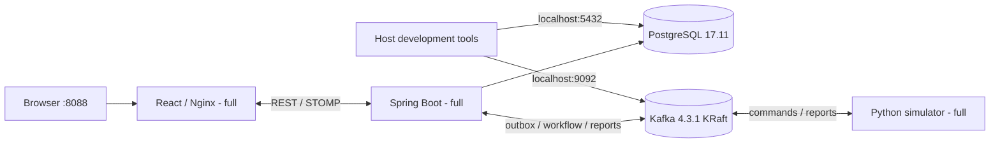

# Docker deployment with one Compose file

> **Manual acceptance update:** the user reports PASS for the normal LHR journey,
> blocked-belt alternative routing, and routing failure with explicit recovery in
> `vortex-manual-test` at http://localhost:8088. See
> [the acceptance record](MANUAL_DOCKER_TEST.md#final-user-reported-manual-browser-acceptance).
> Earlier manual-acceptance limitations below describe the state before that
> confirmation. Other manual/platform checks remain unverified; no additional
> browser tests or artifacts are claimed.

This post-Phase-6 deployment uses exactly **one** file, `compose.yaml`.
The completed `v0.6.0-phase6-demo` milestone at
`c08cbc2ddb549d94c75a9a956cd5c0173e33e832`, all six authoritative documents,
Dockerfiles, Nginx proxy and production workflow remain unchanged. This is a
local educational simulator, not production-ready or safety-certified equipment.

## Modes and commands

Docker Engine with Compose, or Docker Desktop using Linux containers, is sufficient
to build/run the stack. Host Java, Gradle, Node, npm, Python and uv are unnecessary
for the containerized application. Optional verification scripts have their own
host requirements below.

**Existing development installations must read the migration section before
allowing Compose to recreate the old Kafka container.** New clones with empty
volumes do not need that migration.

Infrastructure-only mode (no active profile):

```bash
docker compose up -d
docker compose ps
```

Only **postgres** and **kafka** start. This preserves the IntelliJ/backend,
Vite/frontend and host Python simulator workflow. Initialize the four topics with
the unchanged `./scripts/dev-start.sh` (which also starts/waits for dependencies),
or `./scripts/kafka-topics.sh` after startup, as before. No backend migrations,
application images or full-stack init service run in default mode.

Full application mode:

```bash
git clone https://github.com/samir-saudagar/vortex.git
cd vortex
docker compose --profile full up --build -d
docker compose --profile full ps --all
```

Open **http://localhost:8088** (also http://127.0.0.1:8088). Initial builds and
Kafka policy verification can take several minutes. Use
`up --build -d --wait --wait-timeout 600` to wait for health. The `full` profile
adds **backend, frontend, simulator and kafka-init**. The first three are
long-running applications; `kafka-init` must exit 0. Do not set COMPOSE_PROFILES=full
permanently if you expect a plain `up` to remain infrastructure-only.

## Services, ports and persistence



There are five long-running services in full mode and one auxiliary topic-init
job. PostgreSQL/Kafka are always available; only the other four services have
`profiles: [full]`. PostgreSQL and Kafka become healthy, the existing four-topic
policy is created/verified, then backend startup/Flyway V1–V5 completes. Frontend
and simulator wait for backend readiness. See Docker's
[startup-condition documentation](https://docs.docker.com/compose/how-tos/startup-order/).

Both modes publish **loopback only**: PostgreSQL `127.0.0.1:5432`, Kafka
`127.0.0.1:9092`; full additionally publishes `127.0.0.1:8088`. This intentionally
preserves the host-development listeners. Internal connections use
`postgres:5432`, `kafka:29092`, `backend:8080`; Kafka advertises its INTERNAL
service DNS listener and a separate HOST listener at localhost's configured port.
Containers never use the host listener for application traffic.

Nginx still forwards relative `/api/`, native `/ws` upgrades, OpenAPI/Swagger UI
and health endpoints. Origin and Idempotency-Key are preserved; exact localhost
and 127.0.0.1 browser origins are allowed without wildcards. The unchanged client
uses relative browser URLs. Nginx re-resolves Docker DNS on backend replacement.

Profiles **do not create separate projects or separate data**. By default, a clone
named `vortex` uses project `vortex` and its project-scoped `postgres-data`,
`kafka-data`, `simulator-journal` volumes. PostgreSQL keeps its original volume
name/path. New Kafka storage is named at `/var/lib/kafka/data`. Its upstream
secrets/shared-config paths are temporary; the init job has no persistent state.
The simulator's fsynced journal remains `/var/lib/vortex/journal/commands.jsonl`.
Never remove a journal while retaining its command stream/offsets, and never run
two simulators against the same stream with different journal identities.

To run another stack alongside development, choose another project name **and**
unused published ports. For example, put POSTGRES port 15432, Kafka port 19092
and HTTP port 8088 in `.env.full` and run:

```bash
docker compose --env-file .env.full -p vortex-full --profile full up --build -d
```

That is still the same `compose.yaml`, not another Compose file. Use the same
project/env options for every lifecycle command. Do not run a host backend or
simulator concurrently against the same application's containerized backend/
simulator; stop host processes or use this independent project instead.

## Existing development data before first recreation

The original development Kafka configuration wrote to
`/tmp/kraft-combined-logs` **inside its container writable layer**. It did not use
the image's anonymous `/var/lib/kafka/data` volume for broker logs. The unified
configuration now uses named storage at `/var/lib/kafka/data`. Applying it to an
old container without migration could lose access to those old records/offsets.
**Do not simply recreate that old broker.** The currently running development
broker was deliberately left untouched during consolidation verification.

One-time adoption procedure for an existing installation:

1. Identify the actual project/container, confirm no live journeys, and stop host
   application/simulator write clients. Keep the original container until a
   complete backup has been verified. PostgreSQL volume and host journal need
   no reset.
2. Stop only the old broker, without removing it (`docker compose stop kafka`).
   Copy its entire `/tmp/kraft-combined-logs` directory to an operator-selected
   backup directory **outside the repository**, using `docker cp`. For the
   inspected default project the source container is `vortex-kafka-1`.
3. Create the intended project's `kafka-data` named volume, labelled for that
   project. Refuse to overwrite a nonempty target. Copy **all** broker/controller
   files, topic partitions, checkpoint/offset metadata and meta.properties from
   the backup; keep their contents and assign Kafka UID/GID 1000. Verify complete
   relative file lists and SHA-256 contents, and flush the target before proceeding.
4. Only after verification, run `docker compose up -d` to use the imported named
   storage. Confirm topic IDs/end offsets, consumer offsets and host connectivity
   match. Retain the original backup for rollback; never repair by deleting data.

Example backup commands (replace the destination with an absolute, empty path;
these are operator instructions, **not executed against existing data here**):

```bash
docker compose ps -q kafka
docker compose stop kafka
docker cp vortex-kafka-1:/tmp/kraft-combined-logs /absolute/outside-repository/kafka-backup
```

On PowerShell, use an absolute Windows destination accepted by `docker cp`.
Import is deliberately an explicit verified operation, not an automatic empty
volume reset. This legacy migration was **NOT VERIFIED on the existing development
broker** because that broker/data were not changed. New-project persistence and
container replacement are verified separately below.

Switching an existing host simulator to containers also requires preserving its
actual command journal. Stop it cleanly, back up the configured host journal
(normally `simulator/.local/command-journal.jsonl`), import its unchanged bytes
into an **empty** intended simulator-journal volume as `commands.jsonl` owned by
UID/GID 10001, and verify its hash before the first container consumption. Do not
start with an empty/different journal for uncertain work. Alternatively, keep the
existing host workflow and run the full profile in an independent project.
Existing standalone full-stack volumes can be reused with their old project name;
set POSTGRES_PASSWORD to the password already stored there (the earlier demo
default was vortex-local-demo). Initialization environment variables do not
rotate passwords on a populated PostgreSQL volume.

## Configuration

Optional: copy `docker/full.env.example` to ignored `.env.full` and use
`docker compose --env-file .env.full --profile full ...`. Without an env file,
the existing development defaults remain unchanged.

| Variable | Default | Meaning |
|---|---|---|
| POSTGRES_DB / POSTGRES_USER | vortex / vortex | Shared database and role in both modes |
| POSTGRES_PASSWORD | vortex-local | Runtime credential, never embedded in images |
| VORTEX_POSTGRES_PORT | 5432 | Published loopback PostgreSQL port |
| VORTEX_KAFKA_PORT | 9092 | Published loopback Kafka port and HOST advertisement |
| VORTEX_HTTP_PORT | 8088 | Full frontend port and exact REST/STOMP origin settings |
| VORTEX_FULL_SIMULATOR_DELAY | 0 | Existing simulator delay |
| VORTEX_FULL_FAILURE_MODE | SUCCESS | Existing simulator failure mode, no new modes |

The four topic contracts/retention/capacities are unchanged: source topics have
3 partitions, replication 1, seven-day retention and 2 MiB transport capacity;
quarantine has 1 partition/32 MiB. The event validator remains 1 MiB. Auto-topic
creation is disabled; default development uses its existing explicit init script,
while full mode runs the profiled one-shot job. Incompatible topic counts stop
initialization rather than recreating topics.

## Lifecycle commands

```bash
docker compose --profile full logs -f --tail=100
docker compose --profile full ps --all
docker compose --profile full exec -T backend curl -fsS http://127.0.0.1:8080/actuator/health/readiness
docker compose --profile full restart --no-deps backend frontend simulator
docker compose --profile full up --build -d
docker compose --profile full stop
docker compose --profile full up -d
```

In default mode omit `--profile full`. A plain `stop` does not select inactive
profiled application services; use the full flag to stop the entire full stack.
`stop` and `down` without `--volumes` preserve named data. For a simulator-only
resume while dependencies are already healthy use
`docker compose --profile full up -d --no-deps simulator`; plain `start simulator`
can restart the completed init dependency and cause a legitimate 30-second
command timeout. Do not enlarge deadlines to hide that delay.

All long-running services retain their tested restart policies and resource caps.
The simulator's health probe is read-only metadata plus journal-lock ownership,
not a complete workflow-progress guarantee. The three non-root application images,
base-image digests, Java 21.0.12.1/Node 22.23.3/Python 3.13.16 pins, locked npm/uv
builds, Nginx config and readiness probes are reused unchanged.

## Explicitly confirmed destructive reset

Both modes of a project share its data. **Never reset the existing development
project to change profiles.** Only for an explicitly created disposable project
named `vortex-full`, after verifying its identity and backing up needed data:

```bash
read -r -p 'Type DELETE VORTEX FULL DATA: ' confirmation
if [ "$confirmation" = 'DELETE VORTEX FULL DATA' ]; then
  docker compose -p vortex-full --profile full down --volumes
fi
```

PowerShell:

```powershell
$confirmation = Read-Host 'Type DELETE VORTEX FULL DATA'
if ($confirmation -ceq 'DELETE VORTEX FULL DATA') {
  docker compose -p vortex-full --profile full down --volumes
}
```

Neither reset was executed. Test scripts retain their isolated volumes/journals.

## Platforms, resources and troubleshooting

The unchanged pinned images share native linux/amd64 and linux/arm64 manifests;
execution evidence is Linux/amd64 only. Docker Desktop on Windows/macOS uses
Linux containers; no host-network mode is required. Shell entry points remain LF
via `.gitattributes`. Allow approximately 3–4 GiB runtime memory, and preferably
6–8 GiB for Docker during builds. These are starting estimates, not measured peak
guarantees. Runtime caps remain PG 512 MiB, Kafka/backend 1 GiB each, simulator
256 MiB and frontend 128 MiB, with a temporary 512 MiB init job.

Port conflict: use the documented port variables for another project; internal
service ports stay fixed. POST 403/STOMP failure: use the configured loopback
frontend port and preserve Origin, never add wildcards. Broker init failure:
inspect kafka-init logs and retained topic policy, never delete topics. Simulator
failure: inspect journal lock/permissions and correct the cause before the
existing explicit retry. Seed flights keep the existing 2020–2030 demo windows;
no eligibility bypass is added. No auth, real hardware integration or cloud
infrastructure is introduced.

## Verification commands

Run the two modes independently in automatically generated projects/volumes:

```bash
python3 scripts/test-docker.py --default-only
python3 scripts/test-docker.py
```

The default-mode check uses host Python standard library and Bash for the existing
Linux developer startup script. Full acceptance still uses Python standard library
plus Docker. These are optional QA tools; application startup needs only Docker.
The scripts choose unused ports, clear implicit COMPOSE_PROFILES for default mode,
verify labels/volumes, save results/logs and stop only their own projects. They do
not reset existing resources. Full mode prefers localhost:8088 when free.

Current consolidation evidence is recorded after the historical section below.
The earlier Phase 6 runner must not be applied to an unmigrated legacy broker:
its dev-start step would recreate that container under the new storage config.
Its prior 71 integration/58 Python/37 frontend passes remain valid evidence for
unchanged business code; merged-profile execution is verified independently.

## Historical two-file verification — 2026-11-06

The following executed results preceded profile consolidation. They establish
unchanged image/application behavior, **not proof of the merged Compose file**.
A fresh profile-specific verification section follows them.


**Core container acceptance: PASS**, using actual Linux/amd64 Docker, Compose
v5.7.0 and isolated project `vortex-docker-test-0e273feb9d7b`. The automated
loopback URL was `http://127.0.0.1:57009`. Evidence:
`/tmp/vortex-docker-test-0e273feb9d7b-hgxt67b4/{results.json,compose.log,services.log}`
and `/tmp/vortex-docker-acceptance-pass.log`, exit 0. All test services were
stopped afterward; volumes/journals were retained. The additional default-port
and container-replacement verification below also passed.

| Executed check | Result |
|---|---|
| Fresh backend image, exact Temurin 21.0.12.1+1, Gradle wrapper 8.14.6 | PASS; build-stage JUnit XML: **70 passed, 0 failed, 47 gated skipped** |
| Fresh frontend image, Node 22.23.3, locked npm ci | PASS; typecheck, **37 tests**, production Vite build |
| Fresh simulator image, Python 3.13.16/locked uv environment | PASS; runtime has kafka-python 3.0.11 and no uv/pytest requirement |
| Clean deployment volume, Flyway and seeds | PASS; zero bags initially, V1–V5 (plus Flyway schema-creation marker), 3 flights and 5 edges |
| Four Kafka topics/policy and ordered dependency gates | PASS; init exited 0 before backend processing; all 5 long-running services healthy |
| Nginx HTML, readiness, REST queries and Origin-bearing POST | PASS; durable 202 through the frontend; foreign-Origin read rejected 403 |
| Native WebSocket/STOMP through Nginx | PASS; handshake, committed state notifications during real movement, final update, forbidden client SEND → ERROR |
| Valid flight → Java route → outbox/Kafka → Python → accepted scans | PASS; cost-12 LHR route, accepted scanner-west then scanner-lhr, durable AT_MAKEUP and completed route |
| Cancelled / unknown flight | PASS; both initially 202, then FLIGHT_NOT_ELIGIBLE / UNKNOWN_FLIGHT asynchronously |
| Blocked candidate, no route, active failure and explicit recovery | PASS; exact inputs/records in BLOCKED_BELT_TEST.md |
| Uncertain command after fsynced intent/process death | PASS; SIMULATOR_EXECUTION_UNCERTAIN at check-in with zero observations; only explicit recovery completes |
| Duplicate completed command | PASS; actual Kafka redelivery committed, journal hash unchanged, bag projection/version unchanged |
| Whole-stack stop/up persistence | PASS; original four completed bag projections/history identical and journal SHA-256 unchanged (20 records) |
| Only frontend published, named-volume ownership | PASS; strict project-prefix checks before fixture SQL; unused upstream Kafka secrets/shared-config paths and CLI data path use tmpfs |

The Kafka image declares `/etc/kafka/secrets`, `/mnt/shared/config` and
`/var/lib/kafka/data` volumes. Full-stack Compose explicitly accounts for all of
them: broker data is named/persistent; unused/generated config paths are tmpfs;
the CLI-only init job has no persistent data. This avoids accidental anonymous
volumes. The Kafka UID owns temporary paths. No authentication secrets are stored
there in this local PLAINTEXT demo.

Image/build evidence: `/tmp/vortex-docker-build.log` (first fresh builds),
`/tmp/vortex-docker-build-java-baseline.log` (exact Java baseline rebuild),
`/tmp/vortex-docker-build-final.log` (corrected final definitions), and copied
actual build-stage JUnit XML `/tmp/vortex-docker-java-xml-frt6vbtf`. The initial
draft used a moving Java 21 tag; the final Dockerfiles pin the exact documented
21.0.12.1 images by multi-architecture digest. Final runtime logs confirm that
version; the Phase 6 milestone was not changed.

The unchanged host developer workflow was also rerun using
`./scripts/verify-phase6.sh`, exit **0**, serial contracts on its development
broker/disposable databases. Evidence: `/tmp/vortex-phase6-verification-FOvs6e`.

| Host regression | Passed | Failed | Skipped |
|---|---:|---:|---:|
| Frontend tests (available host Node 24.19.0) | 37 | 0 | 0 |
| Fresh backend build/default | 70 | 0 | **47 gated** |
| Enabled isolated PostgreSQL/Kafka integration, including 8 JVM checkpoints | 71 | 0 | 0 |
| Separately enabled Java Kafka smoke | 1 | 0 | 0 |
| Python 3.13.16, real Kafka contracts enabled | **58** | 0 | 0 |

Typecheck/build, shell/Python syntax and `git diff --check` passed. The Python
increase from 56 to 58 is the two new container-health tests. No required suite
was environment-blocked; skips are not passes, and overlapping image/host runs
are not summed as unique tests. No backend/frontend/simulator business source,
schema, topology, lockfile, original Compose configuration or Phase 6 report was
changed. Only deployment files, the acceptance harness, two probe tests and
README/new documentation were added/updated.

### Earlier unsuccessful iterations retained

These are not reported as successful full-stack runs:

1. `vortex-docker-test-dc3332a389d4` (evidence suffix `xnw16ksx`): simulator ran,
   but the new probe used an unsupported Kafka option. Actual container traceback
   `/tmp/vortex-docker-health-red.log`; focused regression **1 failed / 1 passed**
   before correction (`/tmp/vortex-docker-probe-red.log`), then **2 passed**
   (`/tmp/vortex-docker-probe-green.log`). Fixed probe only; no core/client-version change.
2. `vortex-docker-test-5a5412385625` (`vdik2nmt`) and
   `vortex-docker-test-f1aed895d30d` (`ssg8s6rn`): strict resource checks rejected
   upstream image-created anonymous secrets/shared-config volumes. All declared
   paths are now explicitly mounted; the guard was retained.
3. `vortex-docker-test-441763a72ddb` (`iawdwxfw`): valid startup/REST/handshake,
   but the probe expected unsupported simple-broker subscription receipts.
   Aligned with the existing Java test: replay an already committed state event
   to establish subscription readiness. No broker/server feature was invented.
4. `vortex-docker-test-c9dcd52c54bf` (`uii8lily`): `compose start simulator`
   restarted its init dependency, delayed consumption, caused the real 30-second
   COMMAND_TIMEOUT, and let the idle no-heartbeat probe socket close. The backend
   correctly stayed at checkin-main. Fixture resumes now use `up --no-deps`;
   deadlines and business rules were preserved.

The migration assertion was also corrected after a read-only query established
6 successful Flyway entries but **5 versioned migrations** (the extra row is
schema creation). No migration/schema was changed to satisfy the assertion.
Each failed project retains its own logs/volumes; none targeted development data.

### Limitations

Windows, macOS, native ARM64 and browser UI acceptance are **NOT VERIFIED by
execution in this task**. Manifest inspection and portable Compose design are
distinct from those platform tests. Exact Node 22.23.3 **was** executed in the
frontend image, closing that environment gap for this deployment only; historical
Phase 6 reports remain unchanged. Automated protocol/component tests do not prove
visual/accessibility behavior or manual blocked-belt acceptance. Hard power loss,
all combined fault windows, production availability and real hardware behavior
are not claimed. The explicitly confirmed destructive reset was not executed.

### Container replacement, default URL and preservation

The additional actual Docker check **passed**, exit 0:
`/tmp/vortex-docker-recreate.log`, evidence
`/tmp/vortex-docker-recreate-hz9ofyp9/{results.json,compose.log,services.log}`.
A temporary orchestration artifact `/tmp/vortex-docker-recreate.py` reused only
the previously successful disposable project. It set VORTEX_HTTP_PORT=8088 and
ran `up -d --force-recreate --wait --wait-timeout 600`, preserving named volumes.
All six container IDs changed. The four original completed bag projections and
full histories remained identical; the journal retained its 20 records and
SHA-256 `be9ee2c974ac18db85c231d323e3f59de2d66269d8a655d6df63ad79b537d00a`.
All four Kafka **topic IDs** remained identical, proving those topics were not
silently replaced by initialization.

**http://localhost:8088 was actually exercised**, as were REST and native STOMP
through the frontend on that port. New test bag `DOCKER-DEFAULT-URL-9621a8c9bd`
(`5e471a11-b9d0-4f56-88f8-ff20fd40c69b`) received 202 and reached AT_MAKEUP only
with accepted west/final scanner observations. A committed final state notification
was received through `/ws`; an unrelated REST Origin still returned 403. The
new journey intentionally added records to this test project **after** the
replacement-preservation comparison. No unchanged-journal claim is made across
that new movement. The test stack was stopped afterward and all its volumes kept.

The separate development stack stayed healthy. Initial/final read-only snapshots
`/tmp/vortex-docker-dev-{before,after}.json` are exactly equal: **17 tables / 1,005
rows**, identical content hashes, and the existing `simulator/.local` journal
SHA-256 `92dfe94cceba06033371b45cbdf1a285859bc39da3e1a39a0b9c4b6d5a7be806`.
During the final Docker-verification window, all **10 development application-topic
partition end offsets** matched (`/tmp/vortex-docker-dev-offsets-{before,after}.json`).
The host regression suite intentionally uses diagnostic topics/test databases;
no claim is made that the whole broker, including diagnostic traffic, was unchanged.
No application database/volume reset, journal removal or legitimate history rollback
was performed. Failed draft test-project data is retained separately.

Final image users were inspected: backend/simulator `10001:10001`, frontend
`101:101`. The runtime JAR excludes test fixtures/dependencies. All protected
production source, original `compose.yaml`, six authoritative documents and the
two Phase 6 reports match the starting milestone. Only these **15** release paths
are intended:

- `.dockerignore`, `.gitattributes`, the former two-file deployment configuration
- `backend/Dockerfile`, `frontend/Dockerfile`, `simulator/Dockerfile`
- `docker/frontend/nginx.conf`, `docker/kafka/init-topics.sh`, `docker/simulator/healthcheck.py`, `docker/full.env.example`
- `scripts/test-docker.py`, `simulator/tests/test_container_health.py`
- `README.md`, `docs/DOCKER_DEPLOYMENT.md`, `docs/BLOCKED_BELT_TEST.md`

**Deployment verification verdict: PASS for the executed Linux/amd64 scope.**
Windows/macOS/ARM64 and manual browser/blocked-belt UI acceptance remain explicitly
NOT VERIFIED. Changes are local for user review/publication; no Git staging,
commit, tag, push, reset, branch switch or Git configuration/credential change
was performed. The existing Phase 6 milestone remains unchanged.

## Single-file profile consolidation — 2026-11-06

**PASS for the executed default/full modes on Linux/amd64.** This is new evidence
for the merged configuration, distinct from the historical two-file checks above.
Only `compose.yaml` remains; the second file was removed **after both merged-mode
acceptance runs passed**. All Dockerfiles, Nginx config, application production
source, Phase 6 functionality, authoritative documents and milestone are unchanged.

| Fresh merged-file check | Actual result / evidence |
|---|---|
| `python3 scripts/test-docker.py --default-only` | **PASS, exit 0**; project `vortex-docker-test-cd6d697afbf4`; `/tmp/vortex-profile-default.log`, `/tmp/vortex-docker-test-cd6d697afbf4-urwmembc/{results.json,compose.log,dev-start.log,services.log}` |
| Default service selection | Exactly postgres/kafka running, no application schema/migrations before init; application/init services inactive |
| Host-development connectivity/policy | PostgreSQL wire response, Kafka ApiVersions response and correct published ports; existing unmodified dev-start/topic scripts passed against this isolated project |
| Default persistence | SQL marker and original Kafka topic ID/message survived container replacement, with no full-profile services started |
| Existing Java host-listener smoke | **1 passed, 0 failed, 0 skipped**, actual create/produce/consume through `127.0.0.1:45239`; `/tmp/vortex-profile-host-smoke.log`, `/tmp/vortex-profile-host-smoke.xml`; broker stopped afterward |
| `python3 scripts/test-docker.py` | **PASS, exit 0**, explicit full profile; project `vortex-docker-test-2db8e9ce06c0`; `/tmp/vortex-profile-full.log`, `/tmp/vortex-docker-test-2db8e9ce06c0-uckxdx7p/{results.json,compose.log,services.log}` |
| Full frontend/REST/STOMP | Actual port **8088**, durable check-in, committed live state/final update, Origin rejection and forbidden client SEND rejection passed |
| Full routing/failures/recovery | Blocked parallel belt excluded, safe NO_ROUTE, explicit routing and movement recovery, uncertain-intent fail-closed, duplicate no-op and scanner-only final arrival passed |
| Full restart persistence | Original four complete bag projections and histories identical; same 20-line journal SHA-256 `c87846a4a2679aa25d7f0a56e05cd318fd263e67b54a7116f75a2b9e2a8cf9ca` |
| Single-file/static checks | Default/full Compose model validation, Python syntax, whitespace and reference checks passed; only one Compose YAML exists |

Default and full verification used **different projects, ports, databases, Kafka
brokers and volumes**, sequentially. No current check failed or was skipped or
environment-blocked. Prior image builds and frontend 37 / backend default 70
with 47 gated skips / enabled integration 71 / Python 58 passes are reused only
for unchanged application/image behavior; those suites were **not reexecuted in
this consolidation**. `up --build` reused the unchanged image build cache. The
fresh Java smoke above is separately executed, not inferred from old evidence.

Before/after original-development snapshots are equal: **17 tables / 1,005 rows**
with identical content hashes and existing journal SHA-256; all **10 application
Kafka partition end offsets** match. Evidence:
`/tmp/vortex-profile-dev-{before,after}.json`,
`/tmp/vortex-profile-offsets-{before,after}.json`. The original `vortex-kafka-1`
and `vortex-postgres-1` stayed running/healthy; neither was recreated, stopped,
reset or migrated. Their old volumes and host command journal were preserved.
All disposable test stacks are stopped; their data remains available for inspection.

**Adoption limitation:** the confirmed legacy broker log storage and host-to-Docker
journal transition still require the explicit migration precautions described
above before an existing project is recreated/switched. No such migration was
performed or claimed verified against the user's records. Windows/macOS/ARM64
and manual blocked-belt UI acceptance remain NOT VERIFIED. No Git mutation occurred.

Changes for this request: `compose.yaml`, `scripts/test-docker.py`,
`docker/full.env.example`, README, this guide and BLOCKED_BELT_TEST; the redundant
second Compose file was removed. The final pending deployment bundle still has
15 intended paths, with `compose.yaml` replacing the previous configuration path.
